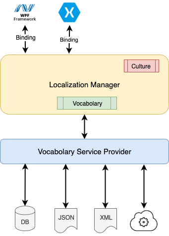

# Localization

[](https://www.nuget.org/packages/Mafesoft.Localization)
[](https://www.nuget.org/packages/Mafesoft.Localization)
[](https://github.com/fmazzant/Localization/actions/workflows/ci.yml)
[](LICENSE.md)
[](https://github.com/fmazzant/Localization/actions/workflows/codeql.yml)
[](#packages)

[](https://www.nuget.org/packages/Mafe.Localization)

**Mafesoft.Localization** is a .NET library to translate your application from **vocabularies you load from any
source** — a database, JSON files, a web API — through a small provider you write. The culture can be **changed at
runtime**: every bound text (XAML, Razor, Blazor) is refreshed immediately, without restarting the application.
The same API works in WPF, .NET MAUI, ASP.NET Core MVC and Blazor.

> **Version 4.0.0: the packages are now published as `Mafesoft.*`** and all the namespaces start with `Mafesoft.`.
> If you are using the `Mafe.Localization*` packages, read [Migrating from `Mafe.Localization`](#migrating-from-mafelocalization).

The changes of every release are listed in the [CHANGELOG](CHANGELOG.md). To report a security problem, read the
[security policy](SECURITY.md).

If Mafesoft.Localization is useful to you, consider [supporting the project](#support). ☕

## Table of contents

- [Why Localization](#why-localization)
- [Features](#features)
- [Comparison with the alternatives](#comparison-with-the-alternatives)
- [Packages](#packages)
- [Installation](#installation)
- [Quick start](#quick-start)
- [How it works](#how-it-works)
- [Vocabulary service provider](#vocabulary-service-provider)
- [LocalizationManager API](#localizationmanager-api)
- [Culture fallback](#culture-fallback)
- [Per-request culture on the server](#per-request-culture-on-the-server)
- [WPF](#wpf)
- [.NET MAUI](#net-maui)
- [ASP.NET Core MVC](#aspnet-core-mvc)
- [Blazor](#blazor)
- [IStringLocalizer](#istringlocalizer)
- [Migrating from `Mafe.Localization`](#migrating-from-mafelocalization)
- [Legacy: Xamarin.Forms](#legacy-xamarinforms)
- [Build and test](#build-and-test)
- [Contributing](#contributing)
- [License](#license)

## Why Localization

`.resx` files and `IStringLocalizer` are compiled into the application: changing a translation means a new build and
a new deploy, and switching language usually means reloading the UI. Mafesoft.Localization is built for the other case:

- **Vocabularies from any source.** You write an `IVocabularyServiceProvider` that loads the terms of a culture from
  wherever they live: a database edited by your translators, JSON files, a remote API, a cache.
- **Culture change at runtime.** `SetCulture` loads the new vocabulary and notifies the bindings: XAML labels, Razor
  views and Blazor components show the new language immediately.
- **The same API everywhere.** `LocalizationManager`, `Translate("key", "default")` and the `{culture:Translate}`
  markup extension work the same way in WPF, .NET MAUI, ASP.NET Core MVC and Blazor.
- **Missing terms are reported.** When a key is not in the vocabulary, the provider is notified
  (`AddOrUpdateTermAsync`), so it can store the new key and your translators see what is missing.

## Features

- Pluggable vocabulary provider (`IVocabularyServiceProvider`), synchronous or asynchronous initialization.
- Runtime culture switch with `SetCulture` / `SetCultureAsync` and the `CultureChanged` event.
- Default values: `Translate("key", "#Default")` never returns null.
- Culture fallback `it-IT` → `it` → invariant → fallback culture, opt-in (`UseParentCultureFallback`, `FallbackCulture`, since 4.3.0).
- XAML markup extension `{culture:Translate Key, DefaultValue=..., StringFormat=...}` for WPF and .NET MAUI.
- ASP.NET Core MVC: `[Translate]` attribute, used by `Html.LabelFor`, `<label asp-for>`, `Html.DisplayNameFor` and the
  validation messages, plus `TranslateLabelFor` / `TranslateLabel` helpers.
- Blazor Server and Blazor WebAssembly: `Binding.Translate` with default value and `StringFormat`.
- `IStringLocalizer` / `IStringLocalizerFactory` backed by the vocabularies, for DataAnnotations and the other
  consumers of `Microsoft.Extensions.Localization` (since 4.1.0).
- Per-request culture on the server (`FollowCurrentUICulture`, with `UseRequestLocalization()`) and vocabularies
  cached per culture (since 4.1.0).
- Nullable reference types annotations, XML documentation, Source Link and symbols.

## Comparison with the alternatives

<!-- markdownlint-disable MD013 -->
| Feature | Mafesoft.Localization | Microsoft.Extensions.Localization (ResX) | LocalizationResourceManager.Maui | WPFLocalizeExtension | My.Extensions.Localization.Json |
|---|---|---|---|---|---|
| Culture change at runtime, bound UI refreshed | ✅ WPF, MAUI, Blazor; per request on the server | ⚠️ per request; Blazor reloads the page | ✅ | ✅ | ⚠️ per request, no UI bindings |
| Translations from your own store (database, API) | ✅ `IVocabularyServiceProvider` | ⚠️ write your own `IStringLocalizerFactory` | ⚠️ custom `ResourceManager` | ✅ `ILocalizationProvider` | ❌ JSON files only |
| Missing keys reported | ✅ `AddOrUpdateTermAsync`, the provider can store them | ⚠️ debug log, `ResourceNotFound` | ❌ | ✅ `MissingKeyEvent` | ✅ log or throw |
| WPF, MAUI, MVC and Blazor with one API | ✅ | ⚠️ MVC and Blazor; no XAML markup | ❌ MAUI only | ❌ WPF only | ❌ ASP.NET Core only |
| `IStringLocalizer` | ✅ since 4.1.0 | ✅ | ❌ | ❌ | ✅ |
| `netstandard2.0` / .NET Framework 4.6.2+ | ✅ | ✅ | ❌ `net10.0` only | ⚠️ .NET Framework only | ❌ `net10.0` only |
| Culture fallback (`it-IT` → `it` → neutral) | ✅ since 4.3.0, opt-in (`UseParentCultureFallback`, `FallbackCulture`) | ✅ | ✅ | ✅ | ✅ |
| Format arguments | ⚠️ `StringFormat` and `IStringLocalizer`; `Translate(key, args)` planned ([#24](https://github.com/fmazzant/Localization/issues/24)) | ✅ | ✅ | ⚠️ converter, not bindable | ✅ |
| Reuse existing `.resx` files | ❌ planned ([#30](https://github.com/fmazzant/Localization/issues/30)) | ✅ | ✅ | ✅ | ❌ |
| Pluralization | ❌ to evaluate ([#33](https://github.com/fmazzant/Localization/issues/33)) | ❌ | ⚠️ zero/one only | ❌ | ❌ |
| Strongly typed keys | ❌ planned ([#31](https://github.com/fmazzant/Localization/issues/31)) | ⚠️ `.resx` designer class, not with `IStringLocalizer` | ❌ | ❌ | ⚠️ `GetString<T>(x => x.Prop)` |
| Native AOT / trimming | ❌ planned ([#32](https://github.com/fmazzant/Localization/issues/32)) | ⚠️ abstractions only | ⚠️ partly annotated | ❌ | ❌ |
| Design-time preview, non-string resources (images, sizes) | ❌ | ❌ | ❌ | ✅ | ❌ |
| Community, documentation, Q&A | ❌ small | ✅ part of .NET | ⚠️ medium | ⚠️ medium, last release 2023 | ⚠️ medium |
<!-- markdownlint-enable MD013 -->

✅ built in, ⚠️ partial or extra work, ❌ not available. Checked in November 2026 against Microsoft.Extensions.Localization 11.0.0,
LocalizationResourceManager.Maui 1.2.6, WPFLocalizeExtension 3.10.0 and My.Extensions.Localization.Json 4.1.0.
The last rows list what the alternatives have and Mafesoft.Localization does not (or only partially), so that the
comparison is not one-sided.

**When to choose something else**

- **`.resx` + `IStringLocalizer`** (Microsoft.Extensions.Localization) when the translations ship with the build and
  change only with a new release: satellite assemblies, culture fallback, `IViewLocalizer` and the largest ecosystem.
- **LocalizationResourceManager.Maui** for a MAUI-only app that already has `.resx` files and wants to switch the language
  at runtime.
- **WPFLocalizeExtension** for a WPF-only app that needs the design-time preview or localizes images, sizes and other
  non-string properties.
- **My.Extensions.Localization.Json** for an ASP.NET Core app that keeps the translations in JSON files next to the code.

## Packages

<!-- markdownlint-disable MD013 -->
| Package | Platform | Target frameworks | NuGet | Downloads | Legacy downloads |
|---|---|---|---|---|---|
| `Mafesoft.Localization` | Core (any .NET application) | .NET 10, .NET 8, .NET Standard 2.0, .NET Framework 4.6.2 | [](https://www.nuget.org/packages/Mafesoft.Localization) | [](https://www.nuget.org/packages/Mafesoft.Localization) | [](https://www.nuget.org/packages/Mafe.Localization) |
| `Mafesoft.Localization.Extensions` | `IStringLocalizer`, dependency injection (since 4.1.0, see [IStringLocalizer](#istringlocalizer)) | .NET 10, .NET 8, .NET Standard 2.0 | [](https://www.nuget.org/packages/Mafesoft.Localization.Extensions) | [](https://www.nuget.org/packages/Mafesoft.Localization.Extensions) | – |
| `Mafesoft.Localization.Wpf` | WPF | `net10.0-windows`, `net8.0-windows` | [](https://www.nuget.org/packages/Mafesoft.Localization.Wpf) | [](https://www.nuget.org/packages/Mafesoft.Localization.Wpf) | [](https://www.nuget.org/packages/Mafe.Localization.Windows) |
| `Mafesoft.Localization.Maui` | .NET MAUI | .NET 10 (MAUI 10), .NET 8 (MAUI 8) | [](https://www.nuget.org/packages/Mafesoft.Localization.Maui) | [](https://www.nuget.org/packages/Mafesoft.Localization.Maui) | [](https://www.nuget.org/packages/Mafe.Localization.Maui) |
| `Mafesoft.Localization.Mvc` | ASP.NET Core MVC | .NET 10, .NET 8 | [](https://www.nuget.org/packages/Mafesoft.Localization.Mvc) | [](https://www.nuget.org/packages/Mafesoft.Localization.Mvc) | [](https://www.nuget.org/packages/Mafe.Localization.Mvc) |
| `Mafesoft.Localization.Blazor` | Blazor Server, Blazor WebAssembly | .NET 10, .NET 8 | [](https://www.nuget.org/packages/Mafesoft.Localization.Blazor) | [](https://www.nuget.org/packages/Mafesoft.Localization.Blazor) | [](https://www.nuget.org/packages/Mafe.Localization.Blazor) |
| `Mafesoft.Localization.Xamarin` | Xamarin.Forms (**deprecated**, see [Legacy](#legacy-xamarinforms)) | .NET Standard 2.0 / 2.1 | [](https://www.nuget.org/packages/Mafesoft.Localization.Xamarin) | [](https://www.nuget.org/packages/Mafesoft.Localization.Xamarin) | [](https://www.nuget.org/packages/Mafe.Localization.Xamarin) |
<!-- markdownlint-enable MD013 -->

Legacy downloads are the downloads of the old `Mafe.Localization.*` packages, up to 3.0.0: `Mafesoft.Localization.Wpf` was
published as `Mafe.Localization.Windows`, `Mafesoft.Localization.Extensions` is new in 4.1.0.

- **.NET 10** (LTS, supported until November 2028) is the main target.
- **.NET 9** is not targeted: it reached end of support on 10 November 2026. .NET 9 applications use the .NET 8 build.
- **.NET 8 is out of support** and is kept **only for compatibility**, so that existing .NET 8 applications can move to
  the `Mafesoft.*` packages without upgrading the runtime at the same time. It will be removed in a future major version.

## Installation

Install the core package and the package for your technology:

```
dotnet add package Mafesoft.Localization
dotnet add package Mafesoft.Localization.Wpf      # or .Maui, .Mvc, .Blazor
```

The technology packages depend on `Mafesoft.Localization`, so for them the second command is enough.

## Quick start

1. Write a provider that loads the vocabularies (here from memory, see [Vocabulary service provider](#vocabulary-service-provider)
   for JSON files):

   ```c#
   using System.Globalization;
   using Mafesoft.Localization;

   public class InMemoryVocabularyServiceProvider : IVocabularyServiceProvider
   {
       private readonly Dictionary<string, Vocabulary> vocabularies = new()
       {
           ["it-IT"] = new Vocabulary { ["Hello"] = "Ciao", ["Welcome"] = "Benvenuto, {0}!" },
           ["en-US"] = new Vocabulary { ["Hello"] = "Hello", ["Welcome"] = "Welcome, {0}!" },
       };

       public Task InitializeAsync(CancellationToken cancellationToken = default) => Task.CompletedTask;

       public Task<IVocabulary> LoadVocabularyAsync(CultureInfo cultureInfo, CancellationToken cancellationToken = default)
           => Task.FromResult<IVocabulary>(vocabularies.TryGetValue(cultureInfo.Name, out var vocabulary) ? vocabulary : new Vocabulary());

       public Task SaveAsync(IVocabulary vocabulary, CancellationToken cancellationToken = default) => Task.CompletedTask;

       public Task AddOrUpdateTermAsync(IVocabulary vocabulary, string key, string? defaultValue = null, CancellationToken cancellationToken = default)
       {
           Console.WriteLine($"Missing term: {key}");
           return Task.CompletedTask;
       }
   }
   ```

2. Initialize the manager, translate and change the culture:

   ```c#
   await LocalizationManager.InitAsync(new InMemoryVocabularyServiceProvider(), new CultureInfo("it-IT"));

   Console.WriteLine(LocalizationManager.Translate("Hello"));                    // Ciao
   Console.WriteLine(LocalizationManager.Translate("Goodbye", "#Goodbye"));      // #Goodbye (and "Missing term: Goodbye")

   await LocalizationManager.Instance.SetCultureAsync(new CultureInfo("en-US"));
   Console.WriteLine(LocalizationManager.Translate("Hello"));                    // Hello
   ```

3. Bind the texts of your UI: [WPF](#wpf), [.NET MAUI](#net-maui), [ASP.NET Core MVC](#aspnet-core-mvc), [Blazor](#blazor).

## How it works



`LocalizationManager.Instance` is a process-wide singleton. It asks the provider for the vocabulary of the current
culture and keeps it in memory. The platform packages bind the UI to the manager: when the culture changes, the manager
raises `PropertyChanged` and `CultureChanged`, and every bound text is read again from the new vocabulary.

> **Server applications:** because the manager is a singleton, in ASP.NET Core MVC and Blazor Server the selected
> culture is shared by all the users of the application. In Blazor WebAssembly each user has their own.

## Vocabulary service provider

A provider implements `IVocabularyServiceProvider`. Every method accepts a `CancellationToken`.

| Method | When it is called |
|---|---|
| `InitializeAsync` | once, by `Init` / `InitAsync` (open a connection, read an index, warm a cache...) |
| `LoadVocabularyAsync(culture)` | at initialization and at every culture change |
| `SaveAsync(vocabulary)` | when you call `LocalizationManager.Instance.SaveCultureAsync()` |
| `AddOrUpdateTermAsync(vocabulary, key)` | when a key is not in the vocabulary (for example to store it for the translators) |

A provider that reads one JSON file per culture (`vocabularies/it-IT.json`, `vocabularies/en-US.json`):

```c#
using System.Globalization;
using System.Text.Json;
using Mafesoft.Localization;

public class JsonVocabularyServiceProvider(string folder) : IVocabularyServiceProvider
{
    public Task InitializeAsync(CancellationToken cancellationToken = default) => Task.CompletedTask;

    public async Task<IVocabulary> LoadVocabularyAsync(CultureInfo cultureInfo, CancellationToken cancellationToken = default)
    {
        var path = Path.Combine(folder, $"{cultureInfo.Name}.json");
        if (!File.Exists(path))
        {
            return new Vocabulary();
        }

        await using var stream = File.OpenRead(path);
        var terms = await JsonSerializer.DeserializeAsync<Dictionary<string, string>>(stream, cancellationToken: cancellationToken);
        return new Vocabulary(terms ?? new Dictionary<string, string>());
    }

    public async Task SaveAsync(IVocabulary vocabulary, CancellationToken cancellationToken = default)
    {
        var path = Path.Combine(folder, $"{LocalizationManager.CurrentCulture.Name}.json");
        await using var stream = File.Create(path);
        await JsonSerializer.SerializeAsync(stream, vocabulary, cancellationToken: cancellationToken);
    }

    public Task AddOrUpdateTermAsync(IVocabulary vocabulary, string key, string? defaultValue = null, CancellationToken cancellationToken = default)
    {
        // Add the missing key with an empty value: SaveCultureAsync() writes it to the file for the translators.
        vocabulary.TryAdd(key, string.Empty);
        return Task.CompletedTask;
    }
}
```

A term with an empty value counts as missing: `Translate` returns the default value.

## LocalizationManager API

```c#
// Initialization (once, at startup). Without a culture the current UI culture is used.
LocalizationManager.Init(provider);
LocalizationManager.Init(provider, new CultureInfo("it-IT"));
await LocalizationManager.InitAsync(provider, new CultureInfo("it-IT"));

// Change the culture: the bindings are refreshed.
LocalizationManager.Instance.SetCulture(new CultureInfo("en-US"));
await LocalizationManager.Instance.SetCultureAsync(new CultureInfo("en-US"));
CultureInfo culture = LocalizationManager.CurrentCulture;

// Translate.
string text = LocalizationManager.Translate("Hello", "#Hello");   // never null: value, default value or key
string? value = LocalizationManager.Instance["Hello"];            // null when the key does not exist

// React to the culture change.
LocalizationManager.Instance.CultureChanged += (sender, e) => Console.WriteLine(LocalizationManager.CurrentCulture);
```

`SetCultureAsync` does not block the caller: use it from a UI thread (WPF, MAUI) when the provider is asynchronous.

```c#
// Since 4.1.0: read the vocabulary of a given culture, whatever the current culture is.
string english = LocalizationManager.Translate("Hello", new CultureInfo("en-US"), "#Hello");
string? value = LocalizationManager.Instance["Hello", new CultureInfo("en-US")];
IVocabulary vocabulary = await LocalizationManager.Instance.GetVocabularyAsync(new CultureInfo("en-US"));
```

The vocabularies are cached per culture: each culture is loaded from the provider once, also when many callers ask
for it at the same time. `SetCulture` reloads the vocabulary of its culture, and `Init` clears the cache.

## Culture fallback

*Since 4.3.0.* By default a key that is not in the vocabulary of the culture returns the default value (or the key).
Like ResX and `IStringLocalizer`, the manager can search the parent cultures first:

```c#
LocalizationManager.Instance.UseParentCultureFallback = true;            // it-IT → it → invariant
LocalizationManager.Instance.FallbackCulture = new CultureInfo("en");    // then en

// or at registration (AddLocalizationManager, AddMvcLocalizationManager, AddBlazorLocalizationManager)
builder.Services.AddMvcLocalizationManager(options =>
{
    options.ServiceProvider = new JsonVocabularyServiceProvider("vocabularies");
    options.UseParentCultureFallback = true;
    options.FallbackCulture = new CultureInfo("en");
});
```

The lookup order is: the culture (`it-IT`) → its parent cultures (`it`, then the invariant culture, with
`UseParentCultureFallback`) → `FallbackCulture` → the default value → the key.

- The provider is asked for the vocabulary of every culture of the chain: `LoadVocabularyAsync(new CultureInfo("it"))`,
  `LoadVocabularyAsync(CultureInfo.InvariantCulture)` (`Name` is an empty string) and so on. Return an empty vocabulary
  for the cultures you do not have.
- The vocabularies of the parent and fallback cultures are loaded only when a key is missing, and then cached like the
  others. A culture that fails to load is skipped.
- The missing term is reported to the provider (`AddOrUpdateTermAsync`, with the vocabulary of the culture) only when
  no culture of the chain has the key. A term with an empty value counts as missing, so the chain goes on.
- `UseParentCultureFallback` is `false` by default in 4.x, so the behavior does not change; `FallbackCulture` is `null`.
- It applies to `Translate`, the indexers, the XAML markup extensions, the MVC and Blazor helpers and `IStringLocalizer`,
  also with `FollowCurrentUICulture` (the chain of the culture of the request).

## Per-request culture on the server

*Since 4.1.0.* By default `LocalizationManager` has **one culture for the whole application**: right for WPF, MAUI
and Blazor WebAssembly, wrong on a server, where `SetCulture` would change the language of every user. On ASP.NET Core
and Blazor Server set `FollowCurrentUICulture`: every lookup then uses `CultureInfo.CurrentUICulture` of the caller,
which the request localization middleware sets for each request (and Blazor Server keeps for each circuit).

```c#
builder.Services.AddMvcLocalizationManager(options =>   // or AddBlazorLocalizationManager / AddLocalizationManager
{
    options.ServiceProvider = new JsonVocabularyServiceProvider("vocabularies");
    options.Culture = new CultureInfo("it-IT");          // loaded at startup
    options.FollowCurrentUICulture = true;
});

var app = builder.Build();

var cultures = new[] { "it-IT", "en-US" };
app.UseRequestLocalization(options => options
    .SetDefaultCulture(cultures[0])
    .AddSupportedCultures(cultures)
    .AddSupportedUICultures(cultures));   // before the endpoints that translate
```

- `Translate`, the indexer, `CurrentCulture`, `CurrentVocabulary`, `[Translate]`, the MVC helpers, `Binding.Translate`
  and `IStringLocalizer` follow the culture of the request.
- The language is chosen by the request culture providers: query string (`?culture=en-US&ui-culture=en-US`), the
  culture cookie and `Accept-Language`. To let the user choose, write the cookie and redirect:

  ```c#
  app.MapGet("/culture/{culture}", (string culture, string redirectUri, HttpContext context) =>
  {
      context.Response.Cookies.Append(CookieRequestCultureProvider.DefaultCookieName,
          CookieRequestCultureProvider.MakeCookieValue(new RequestCulture(culture)));
      return Results.LocalRedirect(redirectUri);
  });
  ```

  In Blazor Server the circuit keeps the culture of the request that opened it: after the redirect the page reloads
  and a new circuit starts with the new language.
- Do not call `SetCulture` to switch the language of a user: with `FollowCurrentUICulture` it only reloads the
  vocabulary of that culture.
- The first request in a culture loads its vocabulary. To load them at startup:
  `foreach (var c in cultures) await LocalizationManager.Instance.GetVocabularyAsync(new CultureInfo(c));`

## WPF

```
dotnet add package Mafesoft.Localization.Wpf
```

Initialize the manager at startup (`App.xaml.cs`):

```c#
protected override void OnStartup(StartupEventArgs e)
{
    LocalizationManager.Init(new JsonVocabularyServiceProvider("vocabularies"), new CultureInfo("it-IT"));
    base.OnStartup(e);
}
```

Translate in XAML:

```xml
xmlns:culture="clr-namespace:Mafesoft.Localization.Wpf;assembly=Mafesoft.Localization.Wpf"

<Label Content="{culture:Translate MainWindow, DefaultValue='Main Window'}" />
<TextBlock Text="{culture:Translate ChangedTimesTemplate, StringFormat='({0})'}" />
```

Or compute a value in code every time the culture changes (`label` is any `FrameworkElement`):

```c#
label.Translate(Label.ContentProperty, () => $"{LocalizationManager.Translate("Hello")} - {DateTime.Now:t}");
```

## .NET MAUI

```
dotnet add package Mafesoft.Localization.Maui
```

Configure the manager in `MauiProgram.cs`:

```c#
var builder = MauiApp.CreateBuilder();
builder
    .UseMauiApp<App>()
    .ConfigureLocalization(new JsonVocabularyServiceProvider(FileSystem.AppDataDirectory), new CultureInfo("it-IT"));
```

Translate in XAML:

```xml
xmlns:culture="clr-namespace:Mafesoft.Localization.Maui;assembly=Mafesoft.Localization.Maui"

<Label Text="{culture:Translate MainWindow, DefaultValue='Main Window'}" />
```

Or compute a value in code every time the culture changes (`label` is any `BindableObject`):

```c#
label.Translate(Label.TextProperty, () => LocalizationManager.Translate("Hello"));
```

## ASP.NET Core MVC

```
dotnet add package Mafesoft.Localization.Mvc
```

Register the manager in `Program.cs`:

```c#
using Mafesoft.Localization.Mvc.Extensions;

var builder = WebApplication.CreateBuilder(args);
builder.Services.AddControllersWithViews();
builder.Services.AddMvcLocalizationManager(options =>
{
    options.ServiceProvider = new JsonVocabularyServiceProvider("vocabularies");
    options.Culture = new CultureInfo("it-IT");   // optional: the current UI culture by default
});
```

Annotate the view model with `[Translate]`:

```c#
using Mafesoft.Localization.Mvc;

public class PersonViewModel
{
    [Translate(ResourceKey = "NameText", DefaultValue = "#Name")]
    public string Name { get; set; } = "";

    [Translate("AddressText", "#Address")]
    public string Address { get; set; } = "";
}
```

The standard helpers use the translation (`Html.LabelFor`, `<label asp-for>`, `Html.DisplayNameFor`, validation
messages), and the library adds two helpers:

```razor
@Html.TranslateLabelFor(m => m.Name)
@Html.TranslateLabel("Title", "TitleKey", "#Default title")
```

By default the culture is shared by all the users and changed with `LocalizationManager.Instance.SetCulture(...)`.
To give every user their own language set `options.FollowCurrentUICulture = true` and add `app.UseRequestLocalization(...)`:
see [Per-request culture on the server](#per-request-culture-on-the-server).

## Blazor

```
dotnet add package Mafesoft.Localization.Blazor
```

**Blazor Web App (interactive server):** register the manager in `Program.cs`.

```c#
using Mafesoft.Localization.Blazor.Extensions;

var builder = WebApplication.CreateBuilder(args);
builder.Services.AddRazorComponents().AddInteractiveServerComponents();
builder.Services.AddBlazorLocalizationManager(options =>
{
    options.ServiceProvider = new JsonVocabularyServiceProvider("vocabularies");
    options.Culture = new CultureInfo("it-IT");
    options.FollowCurrentUICulture = true;   // since 4.1.0: one language per circuit, with app.UseRequestLocalization(...)
});
```

With `FollowCurrentUICulture` every circuit uses the culture of the request that opened it (see
[Per-request culture on the server](#per-request-culture-on-the-server)); without it the culture is shared by all
the users and changed with `SetCulture`.

**Blazor WebAssembly:** the package does not depend on the ASP.NET Core shared framework, so it runs in the browser
too. Initialize the manager asynchronously: a provider that loads the vocabularies with `HttpClient` cannot be waited
synchronously on the single WebAssembly thread.

```c#
var builder = WebAssemblyHostBuilder.CreateDefault(args);
builder.RootComponents.Add<App>("#app");

await LocalizationManager.InitAsync(new InMemoryVocabularyServiceProvider(), new CultureInfo("it-IT"));
builder.Services.AddSingleton(LocalizationManager.Instance);

await builder.Build().RunAsync();
```

Translate in a component with `Binding.Translate`, and refresh the component when the culture changes:

```razor
@using Mafesoft.Localization.Blazor.Bindings
@implements IDisposable

<h1>@Binding.Translate("BlazorCounter", "#Counter")</h1>
<p>@Binding.Translate("ChangedTimesTemplate", stringFormat: "({0})")</p>

@code {
    protected override void OnInitialized() => LocalizationManager.Instance.CultureChanged += OnCultureChanged;
    private void OnCultureChanged(object? sender, EventArgs e) => InvokeAsync(StateHasChanged);
    public void Dispose() => LocalizationManager.Instance.CultureChanged -= OnCultureChanged;
}
```

The samples `samples/Localization.Samples.AppBlazor` (Blazor Web App) and `samples/Localization.Samples.AppBlazorWasm`
(Blazor WebAssembly) show both models.

## IStringLocalizer

```
dotnet add package Mafesoft.Localization.Extensions
```

*Since 4.1.0.* The `Mafesoft.Localization.Extensions` package plugs the vocabularies into
`Microsoft.Extensions.Localization`: `IStringLocalizer`, `IStringLocalizer<T>` and `IStringLocalizerFactory` read the
vocabulary of the current culture, so DataAnnotations, `IViewLocalizer`, Blazor components and third-party libraries
use the same translations.

```c#
using Mafesoft.Localization.Extensions;

builder.Services.AddLocalizationManager(options =>
{
    options.ServiceProvider = new JsonVocabularyServiceProvider("vocabularies");
    options.Culture = new CultureInfo("it-IT");
})
.AddStringLocalizer();

// ASP.NET Core MVC: [Display(Name = "...")] and the validation messages are translated too
builder.Services.AddControllersWithViews().AddDataAnnotationsLocalization();
```

```c#
public class HomeController(IStringLocalizer<HomeController> localizer) : Controller
{
    public IActionResult Index() => View(model: localizer["Welcome"].Value);
}
```

- A missing key returns the key itself with `ResourceNotFound = true`, and the provider is notified
  (`AddOrUpdateTermAsync`), like `LocalizationManager.Instance[key]`.
- `localizer["Format", arg]` formats the value with the current culture; `GetAllStrings()` returns the current vocabulary.
- By default every localizer reads the same keys. With `.AddStringLocalizer(o => o.UseTypeNamePrefix = true)` the keys
  are prefixed with the type name: `IStringLocalizer<HomeController>["Title"]` reads `HomeController.Title`.
- `AddStringLocalizer()` replaces an `IStringLocalizerFactory` registered before, for example by `AddLocalization()`.
- On a server set `options.FollowCurrentUICulture = true` and add `app.UseRequestLocalization(...)`, so the localizers
  follow the culture of each request (see [Per-request culture on the server](#per-request-culture-on-the-server)).
  The [package README](src/Localization.Extensions/README.md#differences-from-the-resx-localizer) lists the
  differences from the resx localizer.

## Migrating from `Mafe.Localization`

4.0.0 is a **breaking release** for every consumer: it renames the packages and the namespaces, and fixes the naming of
the public API in the same release, so that you migrate only once. The `Mafe.Localization*` packages are deprecated on
NuGet.org and point to the new `Mafesoft.*` packages.

**1. Packages** ([#12](https://github.com/fmazzant/Localization/issues/12))

| 3.x package | 4.0.0 package |
|---|---|
| `Mafe.Localization` | `Mafesoft.Localization` |
| `Mafe.Localization.Maui` | `Mafesoft.Localization.Maui` |
| `Mafe.Localization.Mvc` | `Mafesoft.Localization.Mvc` |
| `Mafe.Localization.Blazor` | `Mafesoft.Localization.Blazor` |
| **`Mafe.Localization.Windows`** | **`Mafesoft.Localization.Wpf`** |
| `Mafe.Localization.Xamarin` | `Mafesoft.Localization.Xamarin` (last release, deprecated) |

**2. Namespaces** (in Razor, update `_ViewImports.cshtml` and `_Imports.razor` too)

| 3.x namespace | 4.0.0 namespace |
|---|---|
| `Localization` | `Mafesoft.Localization` |
| `Localization.Providers` | `Mafesoft.Localization.Providers` |
| `Localization.Maui.*` | `Mafesoft.Localization.Maui.*` |
| `Localization.Maui.Converts` | `Mafesoft.Localization.Maui.Converters` |
| `Localization.Mvc.*` | `Mafesoft.Localization.Mvc.*` |
| `Localization.Blazor.*` | `Mafesoft.Localization.Blazor.*` |
| `Localization.Windows.*` | `Mafesoft.Localization.Wpf.*` |
| `Localization.Xamarin.*` | `Mafesoft.Localization.Xamarin.*` |
| `Localization.Xamarin.Converts` | `Mafesoft.Localization.Xamarin.Converters` |

**3. XAML namespaces**

```xml
<!-- MAUI -->
xmlns:culture="clr-namespace:Localization.Maui;assembly=Mafe.Localization.Maui"                 <!-- 3.x -->
xmlns:culture="clr-namespace:Mafesoft.Localization.Maui;assembly=Mafesoft.Localization.Maui"    <!-- 4.0 -->

<!-- WPF -->
xmlns:culture="clr-namespace:Localization.Windows;assembly=Mafe.Localization.Windows"           <!-- 3.x -->
xmlns:culture="clr-namespace:Mafesoft.Localization.Wpf;assembly=Mafesoft.Localization.Wpf"      <!-- 4.0 -->
```

**4. Public API** ([#15](https://github.com/fmazzant/Localization/issues/15))

| 3.x | 4.0.0 |
|---|---|
| `IVocabolary`, `Vocabolary` | `IVocabulary`, `Vocabulary` |
| `IVocabolaryServiceProvider` | `IVocabularyServiceProvider` |
| `Initialize()` | `InitializeAsync(CancellationToken cancellationToken = default)` |
| `LoadVocabolaryAsync(CultureInfo)` | `LoadVocabularyAsync(CultureInfo, CancellationToken cancellationToken = default)` |
| `SaveAsync(IVocabolary)` | `SaveAsync(IVocabulary, CancellationToken cancellationToken = default)` |
| `AddOrUpdateTermAsync(vocabolary, key, defaultValue)` | `AddOrUpdateTermAsync(vocabulary, key, defaultValue, CancellationToken cancellationToken = default)` |
| `IBinding.ConverterParamenter` (Blazor) | `IBinding.ConverterParameter` |

A custom provider must rename `Initialize` to `InitializeAsync` and add the `CancellationToken` parameter to every
method. `LocalizationManager.InitAsync`, `SetCultureAsync`, `LoadOrUpdateCultureAsync` and `SaveCultureAsync` also
accept an optional `CancellationToken`, which is passed to the provider.

The API is annotated for nullable reference types: the indexer `LocalizationManager.Instance[key]` returns `string?`,
`Translate` returns `string` ([#17](https://github.com/fmazzant/Localization/issues/17)).

**5. Target frameworks** ([#14](https://github.com/fmazzant/Localization/issues/14))

- .NET 9 targets removed: .NET 9 applications use the .NET 8 build.
- Core: the .NET Framework 4.7.2 / 4.8 and .NET Standard 2.1 builds are removed; those applications use the
  .NET Framework 4.6.2 and .NET Standard 2.0 builds.

The full list of changes is in the [CHANGELOG](CHANGELOG.md).

## Legacy: Xamarin.Forms

> ⚠️ `Mafesoft.Localization.Xamarin` 4.0.0 is the **last release** of the Xamarin package and it is **deprecated**:
> Xamarin.Forms has been out of support since May 1, 2024. It will receive no further updates or fixes.
> Use it only to align with the `Mafesoft.*` packages while you migrate to .NET MAUI.

It works like the MAUI package (`LocalizationManager.Init(...)` at startup, then `{culture:Translate ...}` in XAML with
`xmlns:culture="clr-namespace:Mafesoft.Localization.Xamarin;assembly=Mafesoft.Localization.Xamarin"`).

To migrate to .NET MAUI, replace the package with `Mafesoft.Localization.Maui`, configure it with
`ConfigureLocalization(...)` and change the XAML namespace to
`clr-namespace:Mafesoft.Localization.Maui;assembly=Mafesoft.Localization.Maui`: the markup extension is the same.

## Build and test

```
dotnet build src/Localization.sln
dotnet test src/Localization.Tests
dotnet test src/Localization.Maui.Tests
dotnet test src/Localization.Wpf.Tests     # Windows only
```

`Localization.Tests` (core, MVC, Blazor, `IStringLocalizer`) runs on .NET 8 and .NET 10, and on Windows also on .NET Framework
(the core tests against the `net462` build); `Localization.Maui.Tests` runs the MAUI controls without a platform head on
.NET 10 (Linux, macOS and Windows); `Localization.Wpf.Tests` runs on .NET 10 on Windows. The samples
(`samples/Localization.Samples.sln`: WPF, MAUI, MVC, Blazor Web App, Blazor WebAssembly, Xamarin) reference the projects
inside `src`, so they always run with the current code.

The CI (`.github/workflows/ci.yml`) runs on Ubuntu and Windows, publishes the code coverage in the job summary and, on
Windows, builds the samples (MAUI with `dotnet workload restore`, Windows head only; Xamarin is not built).

`global.json` pins the .NET 10 SDK (any newer feature band is accepted). The package versions of the projects in `src`
are defined in one place, `src/Directory.Packages.props` (Central Package Management); `src/nuget.config` restores them from
nuget.org only. `.editorconfig` holds the code style.

### Release

All the packages share one version, `<VersionPrefix>` in `src/Directory.Build.props`. To publish a release:

1. update `<VersionPrefix>` and the [CHANGELOG](CHANGELOG.md);
2. create a GitHub release with the tag `v<version>` (e.g. `v4.1.0`, or `v4.1.0-beta.1` for a prerelease).

The `NuGet` workflow (`.github/workflows/nuget.yml`) runs only for `v*` tags: it fails if the tag does not match `<VersionPrefix>`, then tests,
packs and publishes all the packages with the same version. Merging to `master` publishes nothing.

Every `dotnet pack` runs the [package validation](https://learn.microsoft.com/dotnet/fundamentals/apicompat/package-validation/overview):
inside a major version the package is compared with the first release of that version (4.1.0 with 4.0.0), so a
breaking API change in a minor or patch version fails the pack. A package first published in a minor version sets
`<PackageFirstVersion>` in its `.csproj` (see `src/Directory.Build.targets`).

The workflow publishes with [NuGet trusted publishing](https://learn.microsoft.com/nuget/nuget-org/trusted-publishing),
with no long-lived API key: the publish job runs in the `production` environment, the `NUGET_USER` secret holds the
nuget.org user name and nuget.org has a trusted publishing policy for owner `fmazzant`, repository `Localization`,
workflow file `nuget.yml` and environment `production` (renaming the file breaks publishing).

## Contributing

Bug reports, ideas and pull requests are welcome.

1. Open an [issue](https://github.com/fmazzant/Localization/issues) that describes the bug or the change.
2. Create a branch from `master` named after the issue (for example `features/42-short-description`).
3. Keep the change focused, add or update the tests, and make sure `dotnet build` (no warnings: nullable warnings are
   errors) and `dotnet test` pass.
4. Update the README and add an entry to the `Unreleased` section of the [CHANGELOG](CHANGELOG.md).
5. Open a pull request that references the issue (`Fixes #42`).

Security problems must not be reported in public issues: see the [security policy](SECURITY.md).

## Support

If Mafesoft.Localization saves you time, you can say thanks with a small donation. It is never required, but it helps me keep the project maintained and up to date.

[](https://paypal.me/fmazzant)

A star on GitHub, a bug report or a pull request help too. Thank you!

## License

Mafesoft.Localization is released under the [MIT License](LICENSE.md).
